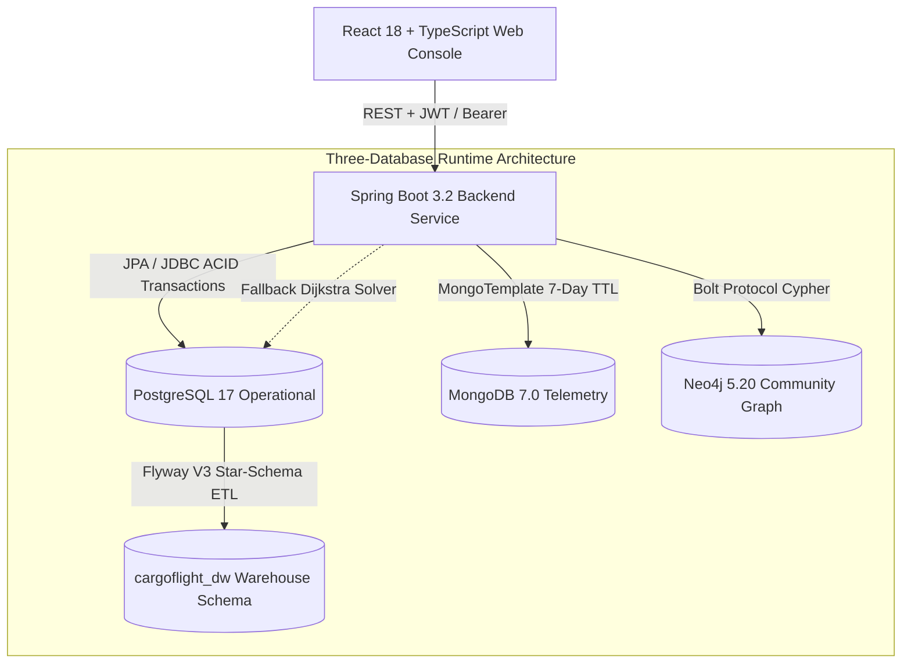

# CARGOFLIGHT System Architecture Documentation

## 1. System Overview & Philosophy

**CARGOFLIGHT** is an enterprise-grade airport cargo-flight and baggage tracking platform built for high-throughput, mission-critical airport operations. It provides end-to-end operational visibility, deterministic route pathfinding, append-only temporal tracking, and multi-database specialization.

The system is designed with strict data isolation:
- **Authoritative Operational State:** Handled exclusively by relational ACID transactions.
- **High-Velocity Telemetry:** Handled by document-oriented time-series storage.
- **Topological Route Computation:** Handled by graph database pathfinding with mathematical solver fallback.
- **Historical Analytics & OLAP:** Handled by a dedicated dimensional schema inside the primary operational relational system.



---

## 2. Three-Database Runtime Architecture

Per project specifications, CARGOFLIGHT eliminates external MySQL dependencies and executes across exactly three database engines:

### 2.1 Primary Database: PostgreSQL 17
- **Database Name:** `aerotrace_india`
- **Port:** `5432`
- **Schemas:**
  1. `public`: Authoritative operational tables: `airports`, `flights`, `handling_points`, `handling_point_connections`, `scanner_devices`, `baggage`, `baggage_movement_history`, `baggage_exceptions`, `system_settings`, `users`, `audit_logs`.
  2. `cargoflight_dw`: Dedicated dimensional star-schema: dimension tables (`dim_terminal`, `dim_flight`, `dim_handling_point`, `dim_baggage_status`), fact tables (`fact_baggage_lifecycle`, `fact_handling_scans`, `fact_flight_baggage_performance`), refresh journal, and OLAP views (`v_olap_volume_by_terminal`, `v_olap_duration_by_stage`, `v_olap_flight_performance`, `v_olap_hourly_throughput`).

### 2.2 Telemetry Database: MongoDB 7.0
- **Database Name:** `aerotrace_telemetry`
- **Port:** `27017`
- **Collection:** `raw_scanner_events`
- **Retention:** Indexed TTL policy expiring documents after 7 days (`604800` seconds).
- **Graceful Degradation:** If MongoDB is offline, operational transactions in PostgreSQL still commit; telemetry ingestion is recorded as bypassed without impacting baggage tracking.

### 2.3 Topological Routing Database: Neo4j 5.20 Community
- **Protocols:** Bolt (`7687`), HTTP Browser (`7474`)
- **Nodes:** `(:HandlingPoint {id, name, category, zone, operationalStatus, capacityPerHour})`
- **Relationships:** `(:HandlingPoint)-[:FEEDS_INTO {distanceMeters, estimatedTraversalSeconds, isActive}]->(:HandlingPoint)`
- **Graceful Fallback:** When Neo4j is offline or disabled, `RouteService` computes shortest paths using an in-memory Dijkstra algorithm querying PostgreSQL `handling_point_connections`.

---

## 3. Transactional Boundaries & State Machine

Baggage movement strictly enforces valid linear stage transitions:

```
REGISTERED
    │
    ▼
CHECKED_IN ───(Security Flag)───> SECURITY_HELD
    │                                  │
    │ (Cleared)                        │ (Cleared)
    └──────────────────┬───────────────┘
                       ▼
               SECURITY_CLEARED
                       │
                       ▼
                     SORTED
                       │
                       ▼
                   IN_TRANSIT
                       │
                       ▼
               READY_FOR_LOADING
                       │
                       ▼
                    LOADED (Aircraft Manifest Incremented)
                       │
                       ▼
                    ARRIVED
                       │
                       ▼
               DELIVERED_TO_BELT
                       │
                       ▼
                    CLAIMED (Passenger Collection)
```

At any point, an exception transition can divert the unit to `EXCEPTION` status for investigation. Invalid transitions (e.g. attempting to jump from `CHECKED_IN` directly to `LOADED`) are rejected with `400 Bad Request` and `InvalidStateTransitionException`.

---

## 4. Security Architecture & RBAC

CARGOFLIGHT implements stateless security using Spring Security 6:
- **Authentication:** Stateless JSON Web Tokens (HMAC-SHA256, 24-hour expiration).
- **Password Protection:** BCrypt hashing (`$2a$10$...`) with legacy dummy hash auto-upgrade.
- **Role Enforcement:** Method-level `@PreAuthorize` guards:
  - `SYSTEM_ADMIN`: Full access to user administration, audit logs, settings, and database center.
  - `OPERATIONS_MANAGER`: Flight scheduling, terminal facility management, settings editing.
  - `BAGGAGE_HANDLER`: Baggage registration, manual stage transitions, scanner event submission.
  - `SECURITY_OFFICER`: Checkpoint security clearances and exception investigation.
  - `ANALYST`: Read-only access to operational metrics and warehouse OLAP reporting.
- **Formula Injection Prevention:** CSV export sanitizes user-controlled text strings starting with `=, +, -, @` with a leading apostrophe.
